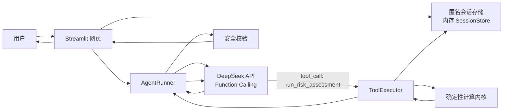

# StudentRiskGuard 初赛 MVP 开发实施方案

- 文档版本：MVP-DEV-1.0
- 适用阶段：MINMAX 黑客松初赛
- 团队：计算机方向 1 人、经济统计方向 1 人
- 目标：完成可公开访问、可匿名试用、可展示真实 Agent 工具调用链路的 MVP

## 1. 结论先行

初赛不要做“大而全的金融平台”，只做一个稳定演示闭环：

```text
匿名表单或合成样本
  -> 服务端创建内存会话
  -> Agent 调用 run_risk_assessment(session_id)
  -> 确定性工具读取会话并计算
  -> 返回结构化风险结果
  -> DeepSeek 只基于工具结果生成解释
  -> 安全校验
  -> 网页展示风险报告
```

MVP 的技术重点不是多 Agent 数量，而是：

1. Agent 必须真实调用工具，而不是把表单直接交给 LLM 算。
2. 所有数值必须来自确定性代码，可复现。
3. LLM 只能看到 `session_id` 和工具返回的结构化结果，不接收原始财务明细。
4. 模型或网络失败时，页面仍能展示计算结果和模板解释。
5. 评委打开公开链接即可完成主流程。

## 2. 固定产品决策

### 2.1 不做账号系统

“可登录打开”按“公开链接可打开、可立即试用”理解。MVP 不实现手机号、学号、密码或第三方账号登录。

- 用户打开网页即可使用。
- 会话使用随机 `session_id` 区分。
- 数据只保存在进程内存，默认 30 分钟过期。
- 页面刷新后允许重新开始，不承诺找回历史。

如果赛事平台要求登录，使用平台自身登录，不在产品内自建账号系统。

### 2.2 表单优先，对话能力后置

初赛主演示使用结构化表单，原因是稳定、可验证、便于评委快速复现。

- P0：表单 + 一键载入四类合成样本。
- P1：自然语言快速录入，由 LLM 解析成表单草稿，用户确认后再计算。
- 不把自然语言对话作为主演示链路的唯一入口。

### 2.3 只保留两个逻辑 Agent

```text
指标计算 Agent = 确定性 Python 工具，不调用大模型
交互推理 Agent = DeepSeek，只解释结构化结果
```

决赛的“情景推演 Agent”不在本阶段实现；MVP 的模拟新增分期仍复用指标计算工具。

### 2.4 不引入重型框架

- 不引入 LangChain、CrewAI、AutoGen、向量数据库或 RAG。
- 使用 `openai` 兼容客户端调用 DeepSeek。
- Agent 编排使用一个明确的 Python 状态机或服务类。
- 页面优先使用 Streamlit，FastAPI 作为同仓库接口适配层。

## 3. MVP 范围

### 3.1 P0 初赛最低交付

| 能力 | 要求 |
|---|---|
| 公开访问 | 部署到 HuggingFace Spaces，打开链接即可使用 |
| 匿名录入 | 两项收入、多笔分期、动态增删 |
| 输入校验 | 负数、空值、异常期数、收入合计为 0 被拦截 |
| 基础计算 | 月供收入比、负债规模、月结余、分期笔数 |
| IRR | 逐笔真实年化，无法求解时明确返回不可用 |
| 压力打分 | 0-100 分、四级风险、维度贡献 |
| 现金流 | 未来 12 个月结余序列和最低月份 |
| Agent 工具调用 | 至少调用 `run_risk_assessment(session_id)` |
| 智能解读 | DeepSeek 生成风险来源、行动建议和科普 |
| 安全降级 | 模型失败时展示计算结果和模板解释 |
| 演示样本 | 低风险、关注、中风险、高风险四组 |
| 隐私 | MVP 不持久化个人明细，不记录金额日志 |

### 3.2 P0+ 完整 MVP

在最低交付稳定后，增加：

- 新增一笔分期模拟。
- 现金流折线图。
- 风险贡献条形图。
- Agent 工具执行状态展示。
- 页面移动端基础适配。

### 3.3 初赛不做

- CSV 批量导入。
- 蒙特卡洛仿真。
- SQLite 历史记录。
- 多轮追问记忆。
- 报告导出。
- 用户自行注册、找回密码或跨设备同步。

## 4. 总体架构



### 4.1 关键链路

1. 页面校验表单，调用服务层创建会话。
2. `SessionStore` 在内存保存 `AssessmentRequest`，返回 `session_id`。
3. `AgentRunner` 请求 DeepSeek，消息中只包含 `session_id` 和任务指令。
4. DeepSeek 返回 `run_risk_assessment(session_id)` 工具调用。
5. `ToolExecutor` 从会话存储读取输入，执行确定性计算。
6. 工具结果返回给 DeepSeek。
7. DeepSeek 返回结构化解释 JSON。
8. 安全层校验字段、禁止内容和数值引用。
9. 前端合并“确定性结果 + 智能解释”并展示。

### 4.2 为什么 LLM 只拿 session_id

- 避免原始个人财务明细发送给第三方模型。
- 满足“计算与解释分离”。
- 保留真实工具调用，方便比赛展示 Agent 执行轨迹。
- 即便模型被提示注入，也无法直接改写计算结果。

## 5. Agent 状态机

```text
RECEIVE
  -> VALIDATE_SESSION
  -> TOOL_CALL_REQUIRED
  -> TOOL_EXECUTING
  -> TOOL_RESULT
  -> EXPLAINING
  -> SAFETY_CHECK
  -> COMPLETED
```

失败分支：

```text
LLM_TIMEOUT / TOOL_CALL_NOT_RETURNED / INVALID_TOOL_ARGS
  -> DETERMINISTIC_FALLBACK
  -> TEMPLATE_EXPLANATION
  -> DEGRADED_RESULT
```

### 5.1 第一轮模型调用

- 目标：让模型调用 `run_risk_assessment(session_id)`。
- 可用工具：仅 `run_risk_assessment`。
- 建议使用强制工具调用；若供应商不支持强制参数，则使用 `auto` 并校验返回中是否包含正确工具调用。
- 如果模型未调用工具：最多重试一次，再进入确定性降级。

### 5.2 第二轮模型调用

- 目标：基于工具结果生成解释。
- 不提供工具。
- 要求返回固定 JSON，不输出 Markdown 代码围栏。
- 禁止模型复述具体金额和利率，数值由前端从工具结果渲染，避免数值不一致。

## 6. 推荐代码目录

```text
StudentRiskGuard/
  AGENTS.md
  README.md
  pyproject.toml
  requirements.txt
  .env.example
  app.py                         # Streamlit 入口，适配 HuggingFace Spaces
  src/riskguard/
    __init__.py
    models/
      assessment.py              # Pydantic 请求、结果、解释模型
      agent.py                   # AgentResponse、ToolTrace
    core/                        # 经济统计方向主要写区
      __init__.py
      metrics.py
      irr.py
      scorecard.py
      cashflow.py
      constants.py
    data/                        # 经济统计方向主要写区
      __init__.py
      demo_cases.py
      synthetic.py
    services/
      session_store.py
      assessment_service.py
      scenario_service.py
    tools/
      definitions.py
      executor.py
    agent/
      runner.py
      prompts.py
      safety.py
      fallback.py
    api/
      main.py
      routes.py
    ui/
      streamlit_app.py
      components.py
      styles.py
  tests/
    test_metrics.py
    test_irr.py
    test_scorecard.py
    test_cashflow.py
    test_session_store.py
    test_tool_executor.py
    test_agent_runner.py
    test_safety.py
    test_api.py
  contracts/
  docs/
  Dockerfile
```

### 6.1 主入口说明

- `app.py` 只负责导入并启动 Streamlit 页面。
- Streamlit 页面调用 `services`，不直接写计算公式。
- FastAPI 路由调用同一个 `services`，避免两套逻辑。
- 所有计算结果最终来自 `core/`。

## 7. 技术栈与依赖

- Python 3.11
- Streamlit
- FastAPI
- Uvicorn
- Pydantic v2
- OpenAI Python SDK（兼容 DeepSeek API）
- Pandas、NumPy
- Plotly 或 Altair（MVP 图表二选一）
- pytest
- python-dotenv

建议先检查当前环境，再锁定版本。不要在未使用的库上浪费时间。

## 8. 环境变量

```dotenv
DEEPSEEK_API_KEY=
DEEPSEEK_BASE_URL=https://api.deepseek.com
DEEPSEEK_MODEL=deepseek-chat
APP_ENV=development
SESSION_TTL_MINUTES=30
LLM_TIMEOUT_SECONDS=30
```

规则：

- `.env` 不提交。
- `.env.example` 只放空值。
- 前端不得直接持有模型密钥。
- 公开部署时通过 HuggingFace Secrets 注入。

## 9. 输入数据与计算口径

### 9.1 输入

- `monthly_disposable_allowance`：每月稳定可支配生活费，已扣除必要支出。
- `monthly_part_time_income`：每月兼职收入。
- 分期数组：`label`、`remaining_principal`、`monthly_payment`、`remaining_periods`、`nominal_apr`。
- `forecast_months`：默认 12。

### 9.2 基础公式

```text
月收入 = 稳定可支配生活费 + 兼职收入
月供合计 = Σ 每笔分期月供
月供收入比 = 月供合计 / 月收入
月结余 = 月收入 - 月供合计
总剩余应还（估算） = Σ 月供 × 剩余期数
```

收入合计必须大于 0。收入为 0 时拒绝计算，不做除零兜底。

### 9.3 IRR

对单笔分期求解：

```text
NPV(r) = remaining_principal - Σ monthly_payment / (1 + r)^t
```

- 求解月利率 r。
- 真实年化 = `(1 + r)^12 - 1`。
- 找不到有效根或现金流方向异常时返回 `unavailable`。
- 不得用名义利率冒充 IRR。

### 9.4 M2 冻结评分卡

> 以下为 M2 采用的四维专家规则评分卡。旧版 40/25/20/15 权重已废弃。计算必须读取配置，不得把阈值散落在代码中。

| 维度 | 最大分 | 输入 | 说明 |
|---|---:|---|---|
| 月供负债收入比 | 35 | 月度固定支出 / 可支配资金 | <30%得0；30%-39%得12；40%-49%得24；≥50%得35 |
| 多头分期笔数 | 15 | 同时持有的分期笔数 | ≤2笔得0；3笔得6；4笔得10；≥5笔得15 |
| IRR真实年化成本 | 20 | 各笔 IRR 的最大值 | <10%得0；10%-23.9%得6；24%-35.9%得12；≥36%得20 |
| 行为与韧性 | 30 | 借贷接续、逾期、资金不足、收入韧性和认知 | 按规则累加并封顶30 |

风险等级：

- 0-24：低风险
- 25-49：关注
- 50-74：中风险
- 75-100：高风险

具体分档和阶梯评分规则见 `contracts/scorecard.example.yaml`。

### 9.5 现金流

```text
第 t 月结余 = 当月收入 - 当月仍在还款的分期月供之和
```

MVP 假设收入固定、月供固定、分期到期后停止扣款。若结余为负，如实显示，不自动补借。

## 10. 页面结构

### 10.1 首页

- 产品名和一句话定位。
- “打开即可试用，无需注册”。
- 边界声明：仅用于金融教育与自查。
- 两个入口：开始自检、载入演示样本。

### 10.2 输入页

- 收入区：稳定可支配生活费、兼职收入。
- 分期区：动态添加/删除多笔记录。
- 校验提示：字段级错误。
- 快捷按钮：低、关注、中、高风险样本。
- 主按钮：开始风险自检。

### 10.3 执行页

显示不涉及思维链的执行状态：

```text
正在校验输入
Agent 正在调用风险评估工具
正在生成解读
安全检查
完成
```

只显示工具名、状态和耗时，不显示模型内部推理过程。

### 10.4 结果页

- 风险等级与 0-100 分。
- 月供收入比、月供合计、月结余。
- 四维贡献拆解。
- 每笔分期 IRR 明细。
- 12 个月现金流折线。
- 智能解读：摘要、风险来源、行动建议、金融科普。
- 固定边界声明。
- 情景模拟入口。

### 10.5 情景页

- 新增分期：名称、本金、月供、期数、名义利率。
- 对比：新增前后月供、月供收入比、风险分、最低结余。
- 明确标注“数学情景，不代表真实借款建议”。

## 11. 异常与降级

| 场景 | 处理 |
|---|---|
| 表单非法 | 前端与后端双重拦截，不进入 Agent |
| DeepSeek 超时 | 展示计算结果 + 模板解释，`degraded=true` |
| 模型未返回工具调用 | 重试一次，再直接执行工具并降级 |
| 工具参数错误 | 返回字段级错误，不继续调用模型 |
| 模型输出非 JSON | 解析失败后使用模板解释 |
| 出现借贷推荐 | 丢弃原输出，使用安全模板 |
| 出现新数值 | 丢弃原解释，数值统一由工具结果渲染 |
| 会话过期 | 提示重新开始，不保留历史 |

## 12. 隐私与日志

- 输入和计算结果只保存在进程内存。
- 日志不得记录金额、月供、利率或完整解释。
- 允许记录：`request_id`、匿名 `session_id` 哈希、工具名、耗时、状态码、错误类型。
- 页面不得使用 localStorage 保存个人明细。
- MVP 不写数据库、不写 CSV、不写本地文件。

## 13. 验收标准

### 13.1 功能验收

- [ ] 四类样本都能完成完整流程。
- [ ] 同一输入连续运行 20 次，核心数值完全一致。
- [ ] Agent 轨迹中能看到 `run_risk_assessment` 成功。
- [ ] 模型输出只引用工具结果，不新增数值。
- [ ] 新增分期模拟不覆盖原始结果。
- [ ] 模型断开时仍能展示计算和模板解释。

### 13.2 合规验收

- [ ] 输入表单无身份字段。
- [ ] 无征信、授信、放款、借贷推荐相关内容。
- [ ] 页面固定展示免责声明。
- [ ] 网络请求中无原始账单文本。
- [ ] 项目目录内无 `.env` 或个人明细文件。

### 13.3 初赛现场验收

- [ ] 评委通过公开链接打开页面。
- [ ] 10 秒内载入样本。
- [ ] 30 秒内看到结果。
- [ ] 能解释清楚 Agent 调用了哪个工具。
- [ ] 能展示模型故障降级。
- [ ] 演示全过程只使用合成样本。

## 14. 开发顺序

严格按以下顺序推进：

1. 冻结数据契约和 Pydantic 模型。
2. 完成确定性计算和测试。
3. 完成工具执行器与会话存储。
4. 完成 Agent 工具调用链。
5. 完成页面输入与结果展示。
6. 完成模拟新增分期。
7. 完成安全降级。
8. 完成公开部署。
9. 完成 Demo 和回归测试。

任何步骤未通过，不开始下一阶段的新功能。

## 15. 时间不足时的裁剪顺序

先保留：

1. 表单输入
2. 四类样本
3. 指标 + IRR + 打分 + 现金流
4. Agent 工具调用
5. 智能解释与降级
6. 公开链接

可依次裁剪：

1. 自然语言输入
2. 风险贡献图表美化
3. 动画和过渡效果
4. 移动端深度适配
5. 情景模拟的复杂交互

不可裁剪：

- 计算与解释分离
- 四类样本
- 降级路径
- 边界声明
- 不持久化个人明细
