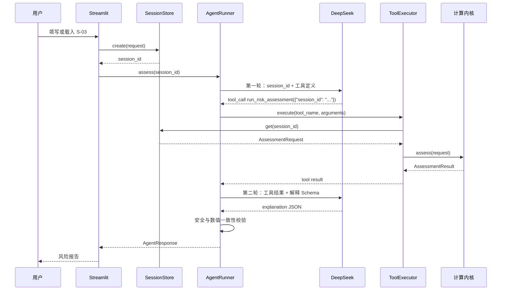

# StudentRiskGuard Agent 开发逻辑与最小框架

- 面向读者：第一次开发 Agent 的计算机同学
- 目标：看懂用户点击“开始自检”后，代码到底做了什么
- 结论：本项目不需要 LangChain、CrewAI 或复杂多 Agent 框架，只需要一个受限的 AgentRunner、一个确定性工具、一个内存会话和一个安全校验层

## 1. 先把 Agent 理解成一个受控工作流

普通后端通常是：

```text
用户提交表单 -> 后端调用固定函数 -> 返回结果
```

本项目多了一步“由大模型决定调用工具”，但范围被严格控制：

```text
用户提交表单
-> 服务端保存匿名会话
-> 大模型看到 session_id
-> 大模型调用 run_risk_assessment(session_id)
-> 服务端执行确定性计算工具
-> 工具返回结构化结果
-> 大模型基于工具结果生成解释
-> 安全校验
-> 返回网页报告
```

所以本项目里的 Agent 不是“让大模型算数”，而是：

- 大模型负责选择并触发评估工具。
- 工具负责所有数值计算。
- 大模型只负责把工具结果解释给学生听。
- 服务端负责状态、校验、降级和边界。

## 2. 五个核心对象

| 对象 | 作用 | 是否调用大模型 |
|---|---|---|
| `AssessmentRequest` | 用户表单的标准结构 | 否 |
| `SessionStore` | 按 session_id 保存匿名输入，只在内存中 | 否 |
| `ToolExecutor` | 执行 `run_risk_assessment` 等工具 | 否 |
| `AgentRunner` | 编排大模型、工具调用和最终响应 | 是 |
| `AssessmentService` | 调用指标、IRR、打分卡和现金流函数 | 否 |

### 2.1 数据关系

```text
AssessmentRequest
  -> 存入 SessionStore
  -> Agent 只拿到 session_id
  -> ToolExecutor 根据 session_id 取出原始输入
  -> AssessmentService 返回 AssessmentResult
  -> AgentRunner 让 DeepSeek 解释 AssessmentResult
  -> 返回 AgentResponse
```

注意：

- `AssessmentRequest` 是用户输入。
- `AssessmentResult` 是确定性计算结果。
- `AgentResponse` 是最终返回给前端的完整响应。
- LLM 不拿到原始 `AssessmentRequest`。

## 3. 完整调用顺序



## 4. 第一步：保存匿名会话

前端把表单转换为 `AssessmentRequest`。

```python
request = AssessmentRequest(
    session_id="anon_20261102_a1b2c3",
    income=Income(
        monthly_disposable_allowance=2200,
        monthly_part_time_income=800,
    ),
    debts=[...],
    forecast_months=12,
)

session_id = session_store.create(request)
```

为什么要有 `SessionStore`：

```text
原始明细 -> 服务端内存
session_id -> 交给大模型
```

第一阶段只需要内存字典，不写数据库、不写文件。

```python
class SessionStore:
    def __init__(self):
        self._data = {}

    def create(self, request):
        self._data[request.session_id] = SessionRecord(request=request)
        return request.session_id

    def get(self, session_id):
        record = self._data.get(session_id)
        if record is None:
            raise SessionNotFound()
        return record
```

实际实现还需要 30 分钟 TTL、删除和过期判断。

## 5. 第二步：第一轮模型请求

第一轮不是让模型算分，而是让模型调用工具。

```python
messages = [
    {"role": "system", "content": SYSTEM_PROMPT},
    {
        "role": "user",
        "content": f"请对匿名会话 {session_id} 执行负债压力评估，先调用工具，不要自行计算。",
    },
]

first = client.chat.completions.create(
    model=MODEL,
    messages=messages,
    tools=TOOLS,
    tool_choice={
        "type": "function",
        "function": {"name": "run_risk_assessment"},
    },
)
```

第一轮模型可以看到：系统规则、session_id、工具定义。

第一轮模型不能看到：生活费金额、月供明细、真实账单、姓名和账号。

## 6. 第三步：解析并执行工具调用

DeepSeek 返回的形态大致是：

```json
{
  "tool_calls": [
    {
      "id": "call_abc123",
      "type": "function",
      "function": {
        "name": "run_risk_assessment",
        "arguments": "{\"session_id\":\"anon_20261102_a1b2c3\"}"
      }
    }
  ]
}
```

代码需要确认工具名、解析参数、读取会话、执行计算。

```python
def _execute_tool(tool_call):
    name = tool_call.function.name
    args = json.loads(tool_call.function.arguments)

    if name == "run_risk_assessment":
        request = session_store.get(args["session_id"]).request
        result = assessment_service.assess(request)
        return {
            "tool_call_id": tool_call.id,
            "name": name,
            "result": result.model_dump(),
        }

    raise ToolNotFound(name)
```

工具本身不调用大模型：

```python
def run_risk_assessment(session_id):
    request = session_store.get(session_id).request
    return assessment_service.assess(request)
```

## 7. 第四步：第二轮模型请求生成解释

工具完成后，把工具结果作为 `role=tool` 消息发回模型。

```python
messages.append(assistant_message)
messages.append({
    "role": "tool",
    "tool_call_id": tool_call.id,
    "content": json.dumps(tool_result, ensure_ascii=False),
})

second = client.chat.completions.create(
    model=MODEL,
    messages=messages,
    response_format={"type": "json_object"},
)
```

第二轮模型可以看：指标值、风险分、风险等级、维度贡献、IRR 状态和现金流序列。

第二轮模型不允许：重算指标、生成新数值、修改风险等级、给出贷款审批或借贷推荐。

解释 JSON 只包含：

```json
{
  "summary": "...",
  "risk_sources": [],
  "actions": [],
  "education": [],
  "questions_to_consider": [],
  "boundary_notice": "本结果仅供金融教育与个人负债压力自查参考，不构成信贷审批、授信、放款或投资建议。"
}
```

具体金额、利率和分数由前端从 `AssessmentResult` 渲染，模型不要在文本里复述数字。

## 8. 第五步：安全校验

模型输出后，`SafetyValidator` 做：

1. Pydantic/JSON Schema 校验。
2. 固定边界声明检查。
3. 禁止意图检查。
4. 未授权数值检查。
5. 失败时替换为模板解释。

```python
try:
    explanation = Explanation.model_validate_json(second.choices[0].message.content)
    explanation = safety.validate(explanation, assessment_result)
except (ValidationError, UnsafeOutput, NumericMismatch):
    explanation = fallback_explanation(assessment_result)
    degraded = True
```

## 9. 第六步：返回 AgentResponse

最终返回给前端的是：

```python
AgentResponse(
    request_id=request_id,
    status="completed" if not degraded else "degraded",
    degraded=degraded,
    tool_activity=[
        ToolActivity(
            tool="run_risk_assessment",
            status="succeeded",
            latency_ms=18,
        )
    ],
    assessment=assessment_result,
    explanation=explanation,
    error=None,
)
```

前端把 `assessment` 渲染为数字和图表，把 `explanation` 渲染为文字。

## 10. AgentRunner 的完整骨架

```python
class AgentRunner:
    def assess(self, session_id: str) -> AgentResponse:
        request_id = new_request_id()
        tool_activity = []

        try:
            first = self._call_model_for_tool(session_id)
            tool_call = self._extract_tool_call(first)
            tool_result = self._execute_tool(tool_call)
            tool_activity.append(
                ToolActivity(
                    tool=tool_call.function.name,
                    status="succeeded",
                    latency_ms=0,
                )
            )

            second = self._call_model_for_explanation(tool_call, tool_result)
            explanation = self._parse_explanation(second)
            explanation = self._validate_safety(explanation, tool_result)

            return AgentResponse(
                request_id=request_id,
                status="completed",
                degraded=False,
                tool_activity=tool_activity,
                assessment=tool_result["result"],
                explanation=explanation,
                error=None,
            )
        except Exception as exc:
            result = self._fallback_direct_tool(session_id)
            return AgentResponse(
                request_id=request_id,
                status="degraded",
                degraded=True,
                tool_activity=tool_activity,
                assessment=result,
                explanation=fallback_explanation(result),
                error={"code": "AGENT_FALLBACK", "message": str(exc)},
            )
```

降级时仍必须直接调用确定性工具，不能返回空页面。

## 11. 前端逻辑

前端只负责四件事：

1. 把表单转换成 JSON。
2. 调用创建会话接口。
3. 调用 Agent 评估接口。
4. 根据 `AgentResponse` 渲染页面。

它不负责计算风险分、修改风险等级、拼接模型原文或保存个人明细。

页面模块：

```text
首页 -> 输入页 -> Agent 执行状态 -> 结果页 -> 情景模拟页
```

### Agent 执行状态展示

只显示：

```text
正在创建匿名会话
Agent 正在调用风险评估工具
正在生成解释
安全检查
完成
```

不显示模型思维链。

## 12. 情景模拟逻辑

新增一笔分期时不覆盖原评估：

```text
原 AssessmentRequest
  -> 复制一份 scenario_request
  -> 加入新 debt
  -> 调用同一个 AssessmentService
  -> 比较 base 和 scenario
```

不是让大模型自己估算“多了 300 元会怎样”。

## 13. 测试逻辑

### 13.1 单元测试

- 指标计算是否正确。
- IRR 是否有解。
- 打分卡是否可解释。
- 现金流是否连续。
- 解析函数是否能拒绝非法输入。

### 13.2 工具测试

- 工具只接收 session_id。
- 工具能从 SessionStore 读取数据。
- 工具返回完整 AssessmentResult。
- 会话过期返回明确错误。

### 13.3 Agent 测试

- 第一轮是否包含 `run_risk_assessment` tool_call。
- 工具结果是否正确回填。
- 第二轮解释是否为合法 JSON。
- 模型失败时是否降级。
- 解释中是否出现未授权数字。

### 13.4 页面测试

- 四类样本能否全部走通。
- 页面数字是否等于工具结果。
- 新增分期是否使用临时副本。
- 模型断开时页面是否不空白。

## 14. 不需要什么

初赛 MVP 不需要：

- LangChain。
- CrewAI。
- AutoGen。
- 向量数据库。
- RAG。
- 多 Agent 自由对话。
- 长期记忆。
- 用户登录。
- 数据库。
- 真实账单上传。

本项目需要的是一个窄而稳的 Agent 状态机，不是通用 Agent 平台。

## 15. 最小实现顺序

```text
1. 写 Pydantic 模型
2. 写 SessionStore
3. 写指标、IRR、打分卡、现金流
4. 写 AssessmentService
5. 写 ToolExecutor
6. 写 AgentRunner
7. 写安全与降级
8. 写 Streamlit 页面
9. 用 S-03 走通一条链路
10. 再补四类样本和情景模拟
```

对应模块：

```text
M1 工程与模型
-> M2 计算内核
-> M3 会话、工具与 API
-> M4 Agent 工具调用
-> M5 页面闭环
-> M6 安全与降级
-> M7 公网提交
```

## 16. 最终判断标准

只要下面这条链路真实发生，核心 Agent 就成立：

```text
用户输入
-> SessionStore
-> DeepSeek 返回 run_risk_assessment tool_call
-> ToolExecutor 执行
-> AssessmentResult
-> DeepSeek 生成解释
-> SafetyValidator 通过
-> 页面展示
```

如果只是页面调用一个 Python 函数直接出结果，那是普通后端，不是本项目要提交的 Agent。

## 17. 最容易误解的地方

### 17.1 “Agent 会计算”吗

不会。Agent 触发工具，工具算数。

### 17.2 为什么还要大模型

因为学生需要的是把结构化指标解释成能理解的语言。没有大模型也可以算分，但交互解释和科普能力会弱。

### 17.3 为什么不能把表单全发给模型

因为财务明细没有必要暴露给第三方模型，而且模型可能算错。模型只需要 session_id 和工具结果。

### 17.4 工具结果是不是也包含个人数据

工具结果只包含计算结果和匿名维度，不包含姓名、学号、账号和账单原文。

### 17.5 模型失败怎么办

直接调用工具，展示计算结果和固定模板解释，并在页面标明“智能解读已降级”。

### 17.6 如果 DeepSeek 不支持强制工具调用

第一轮改为 `tool_choice="auto"`，检查返回中是否有正确 tool_call；如果没有，重试一次，再进入确定性降级。降级不影响计算结果，但不能在主演示中把它伪装成成功工具调用。

## 18. 你第一次写代码时怎么做

不要从 Streamlit 页面开始。按以下顺序：

1. 先让 `AssessmentRequest` 能被 Pydantic 解析。
2. 再让 S-03 样本能算出指标和现金流。
3. 再写 `SessionStore` 和 `ToolExecutor`。
4. 再写一个假的 LLM 响应，让 AgentRunner 跑通工具调用。
5. 再接真实 DeepSeek。
6. 再做页面。
7. 最后做安全降级和公网部署。

这样每一步都有可验证结果，不会一开始就被 Agent 框架和前端细节淹没。
